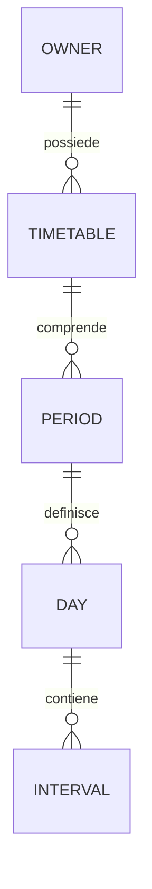

# Progetto del pacchetto Timetables

`ilbronza/timetables` gestisce gli orari ricorrenti di un modello Laravel e permette di cercare nel database i modelli attivi a un certo istante o durante un intervallo. La prima versione usa tabelle relazionali, regole settimanali, periodi di validità ed eccezioni per data. Il calcolo temporale è interno al pacchetto; Spatie resta un riferimento, senza dipendenza a runtime.

Il nucleo Laravel è implementato: migrazioni, modelli, servizi, trait, ricerche e comando di verifica della configurazione. Il [README](../README.md) documenta le API effettive. Il prototipo SQL rimane un riferimento indipendente per la semantica; i test del pacchetto esercitano il codice PHP su SQLite. La verifica su MySQL e l’adattatore grafico sono passi successivi.

## Collocazione e confini

Il pacchetto risiede in `Timetables/`, con namespace `IlBronza\Timetables`, configurazione `timetables` e tabelle con prefisso `timetables__`.

| Esigenza | Responsabilità |
| --- | --- |
| Apertura di un'azienda, reperibilità, lavoro settimanale | Timetables |
| Ricorrenza di un corso o di un allenamento | Timetables collegato al corso, alla squadra o a un modello di attività |
| Lezione del 12 ottobre, prenotazione, presenze e capienza | Modelli del dominio, per esempio `courses` |
| Occupazione concreta di un operatore o di uno strumento | `Processes` |
| Durate produttive e tempi stimati | `Timings` |
| Scadenze e notifiche | `Schedules` |
| Visualizzazione Gantt | `Timeline`, come eventuale consumatore |

Un orario dice quando un soggetto è attivo. Due attività con istruttori, sale o capacità diverse devono avere modelli distinti a cui collegare l'orario: questi dati non diventano attributi degli intervalli. La disponibilità prenotabile si ottiene combinando l'orario con gli impegni effettivi del dominio.

La prima versione comprende ricorrenze settimanali, più fasce al giorno, turni notturni, eccezioni, orari stagionali con date esplicite e fusi orari IANA. Ricorrenze RRULE, settimane alterne, festività automatiche, prenotazioni e generazione di lezioni sono estensioni successive, ciascuna con proprie regole.

## Decisioni principali

- Persistenza relazionale: le informazioni necessarie a filtrare non sono nascoste in JSON.
- Quattro tabelle: un'intestazione per soggetto e finalità, periodi di validità, giorni, intervalli.
- Un'eccezione sostituisce l'intera data civile, inclusa la coda del giorno precedente.
- Intervalli con inizio incluso e fine esclusa: `[inizio, fine)`.
- Gli orari sono locali; le ricerche ricevono istanti assoluti, con offset esplicito.
- SQL diretto per attività a un istante e sovrapposizione; nessuna generazione preventiva obbligatoria di occorrenze.
- Modelli Eloquent semplici nel nucleo; adattamento all'interfaccia della suite separato dal calcolo.

## Modello relazionale



### Intestazione

Tabella `timetables__timetables`, modello `Timetable`.

| Campo | Tipo e significato |
| --- | --- |
| `id` | UUID, chiave primaria |
| `owner_type`, `owner_id` | Relazione polimorfica al soggetto |
| `kind` | Stringa, massimo 64 caratteri: `opening`, `working`, `training` ecc. |
| `name` | Etichetta facoltativa |
| `timezone` | Identificatore IANA, per esempio `Europe/Rome` |
| `enabled` | Booleano, predefinito vero |
| `revision` | Intero crescente per gestire modifiche concorrenti |
| `created_at`, `updated_at`, `deleted_at` | Timestamp; cancellazione logica solo sull'intestazione |

Vincolo univoco su `(owner_type, owner_id, kind)`, valido anche per intestazioni cancellate logicamente. Ricreare lo stesso orario richiede il ripristino esplicito dell'intestazione esistente. Si evita così di avere due identità concorrenti per la stessa finalità.

`owner_id` è una stringa di massimo 64 caratteri, con rappresentazione canonica della chiave originale: supporta le normali chiavi intere, UUID e ULID. `owner_type` segue `getMorphClass()` e l'eventuale morph map dell'applicazione. Il provider non impone una morph map globale. Le chiavi composite non sono supportate.

Le query confrontano l'identificativo stringa con la rappresentazione stringa della chiave del modello tramite il grammar del database, evitando confronti numerici permissivi fra identificativi. Il tipo polimorfico è sempre parte del filtro. L'applicazione deve conservare stabili gli alias oppure migrare i valori già registrati.

I confronti su tipo, identificativo e finalità devono avere la stessa sensibilità alle maiuscole sui database supportati: collation binaria per questi campi e confronti coerenti nel grammar. Gli identificativi vengono normalizzati secondo il tipo della chiave, senza trasformare arbitrariamente chiavi stringa personalizzate.

### Periodi di validità

Tabella `timetables__periods`, modello `TimetablePeriod`.

| Campo | Tipo e significato |
| --- | --- |
| `id` | UUID |
| `timetable_id` | FK all'intestazione, cancellazione fisica a cascata |
| `valid_from` | Data civile locale inclusa; `null` significa senza limite iniziale |
| `valid_to` | Data civile locale inclusa; `null` significa senza limite finale |
| `name` | Etichetta facoltativa, per esempio «Estate 2027» |
| `created_at`, `updated_at` | Timestamp |

Quando entrambi i limiti sono valorizzati deve valere `valid_from <= valid_to`, con validazione del writer e relativo `CHECK`. I periodi della stessa intestazione non possono sovrapporsi. La verifica avviene nella transazione di scrittura, dopo avere bloccato l'intestazione. Un indice su `(timetable_id, valid_from, valid_to)` agevola la ricerca del periodo applicabile.

All'inizio basta un periodo con entrambi i limiti nulli. Per programmare un cambiamento si chiude il precedente e si aggiunge il successivo nella stessa transazione. Gli orari estivi e invernali si rappresentano con periodi distinti, senza regole annuali implicite.

I periodi descrivono la validità degli orari, non costituiscono un registro immutabile delle modifiche. Un eventuale audit applicativo resta separato.

### Giorni settimanali ed eccezioni

Tabella `timetables__days`, modello `TimetableDay`.

| Campo | Tipo e significato |
| --- | --- |
| `id` | UUID |
| `period_id` | FK al periodo, cancellazione a cascata |
| `weekday` | Intero ISO da 1, lunedì, a 7, domenica; nullable |
| `on_date` | Data civile locale; nullable |
| `label` | Etichetta facoltativa, utile per la motivazione di un'eccezione |
| `created_at`, `updated_at` | Timestamp |

Esattamente uno fra `weekday` e `on_date` deve essere valorizzato. Vincoli univoci separati su `(period_id, weekday)` e `(period_id, on_date)`.

Una riga con `weekday` definisce una regola settimanale. Una riga con `on_date` è una sostituzione per quella data, che deve appartenere al periodo. **Un'eccezione senza intervalli significa chiusura completa**: la presenza della riga ha significato e non va eliminata durante la normalizzazione.

Un giorno settimanale assente equivale a nessuna fascia. Il writer può mantenere sette righe settimanali per rendere più semplice l'editor; la semantica non dipende dalla loro presenza fisica.

### Intervalli

Tabella `timetables__intervals`, modello `TimetableInterval`.

| Campo | Tipo e significato |
| --- | --- |
| `id` | UUID |
| `day_id` | FK al giorno, cancellazione a cascata |
| `start_minute` | Minuti dall'inizio del giorno di origine, da 0 a 1439 |
| `end_minute` | Minuti dall'inizio dello stesso giorno, anche oltre 1440 |
| `created_at`, `updated_at` | Timestamp |

Valgono `end_minute > start_minute` ed `end_minute <= start_minute + 1440`: durata massima di 24 ore civili per singola fascia. Indice su `(day_id, start_minute)`.

| Orario inserito | Valori memorizzati |
| --- | --- |
| 09:00–13:00 | `540, 780` |
| 14:30–18:00 | `870, 1080` |
| 22:00–02:00 del giorno successivo | `1320, 1560` |
| Intera giornata | `0, 1440` |

Il trasporto può usare `HH:mm` e un flag esplicito `ends_next_day`. Il valore `24:00` è ammesso solo come fine del giorno. Inizio e fine uguali, senza indicazione di giorno successivo, sono invalidi: non significano automaticamente 24 ore.

Le fasce rappresentano un insieme di tempo attivo. Il writer ordina le righe ed elimina i duplicati esatti; conserva le altre fasce, anche se sovrapposte o adiacenti. L'unione si calcola durante la lettura. Fondere le righe in scrittura potrebbe violare il limite di 24 ore: per esempio `[0, 1440)` e `[1320, 1560)` sono singolarmente valide, ma la loro unione supera quel limite.

Le singole fasce non contengono metadati di lezioni o prenotazioni. Le code notturne si conservano sul giorno di origine. Il writer applica un limite configurabile, inizialmente 32 fasce per giorno, e verifica nuovamente i vincoli dopo la normalizzazione.

I vincoli locali diventano validazioni applicative e `CHECK` nelle migrazioni. Il supporto iniziale da verificare è MySQL 8.0.17 o successivo e SQLite. Le invarianti fra righe, come la disgiunzione dei periodi, richiedono il writer anche quando il database supporta i `CHECK`.

## Regole temporali

### Stato e assenza di dati

`stateAt()` restituisce uno fra:

- `Active`: l'istante appartiene a una fascia effettiva.
- `Inactive`: esiste un periodo applicabile, ma l'istante non è coperto.
- `Unconfigured`: manca l'intestazione abilitata oppure manca un periodo valido.

`isActiveAt()` restituisce vero soltanto per `Active`. L'interfaccia può quindi distinguere «chiuso» da «orario non disponibile». Gli scope di ricerca includono solo i modelli attivi.

### Selezione del giorno e precedenza

Per un periodo `P` e una data locale `D`, `R(P, D)` indica gli intervalli dell'eccezione datata, se presente, altrimenti quelli del relativo giorno settimanale.

Le fasce effettive della data `D` sono l'unione di:

1. La parte di `R(P, D)` compresa fra la mezzanotte e la fine di `D`.
2. La coda oltre mezzanotte di `R(P, D − 1)`, soltanto se `D` non ha un'eccezione e lo stesso periodo è valido anche per `D − 1`.

La riga eccezionale sostituisce quindi l'intera data. La fine di un periodo taglia le eventuali code alla mezzanotte successiva: una fascia non attraversa il confine verso un altro periodo o un giorno non configurato.

| Situazione | Risultato |
| --- | --- |
| Lunedì 22–02; martedì senza fasce né eccezioni | Martedì attivo 00–02 |
| Lunedì 22–02; martedì eccezione vuota | Martedì completamente chiuso |
| Lunedì 22–02; martedì eccezione 10–12 | Martedì attivo soltanto 10–12 |
| Lunedì eccezione 23–03; martedì ordinario | Martedì eredita 00–03, oltre alle proprie fasce |
| Periodo A termina lunedì; periodo B inizia martedì | Nessuna coda di A entra in B |
| Fascia 09–13; ricerca alle 13:00 esatte | Inattivo |

La rimozione di un'eccezione ripristina regola settimanale e possibili code. La sostituzione con un'eccezione vuota chiude il giorno: sono operazioni differenti.

### Fusi orari e cambio dell'ora

Il fuso appartiene all'intestazione, non al server o al visitatore. Le date di validità e i minuti hanno significato civile in quel fuso. Gli istanti delle API sono `DateTimeInterface`, inclusi Carbon, oppure timestamp con offset esplicito; una stringa locale ambigua non viene interpretata automaticamente.

La regola è: un istante è attivo se, convertito nel fuso dell'orario, il suo orologio locale cade in una fascia effettiva. Questo determina il comportamento al cambio dell'ora:

- In primavera, i minuti inesistenti non producono tempo effettivo.
- In autunno, i minuti ripetuti valgono entrambe le volte.
- Una giornata intera può durare 23 o 25 ore effettive; non si assume che ogni transizione sia di un'ora.

Per esempio, a Roma il 25 ottobre 2026 la fascia 02:15–02:45 produce due intervalli UTC: 00:15–00:45 e 01:15–01:45. Il vuoto fra essi rimane un vuoto. Il 29 marzo 2026 la stessa fascia non produce intervalli, perché quell'ora locale non esiste.

La conversione non deve costruire ingenuamente un `DateTime` locale per ciascun estremo: la normalizzazione di orari inesistenti o ambigui può cambiare la regola. Si usano invece segmenti UTC a offset costante ricavati da [`DateTimeZone::getTransitions()`](https://www.php.net/manual/en/datetimezone.gettransitions.php), passando entrambi i limiti temporali. UTC e fusi senza transizioni nel periodo hanno un solo segmento.

Su MySQL la collation `utf8mb4_0900_bin` preserva anche la distinzione degli spazi finali negli identificativi; è disponibile da [MySQL 8.0.17](https://dev.mysql.com/doc/relnotes/mysql/8.0/en/news-8-0-17.html).

Precisione di configurazione: un minuto. Precisione degli istanti e dei confronti: microsecondo, con interi a 64 bit. Non si arrotonda l'istante al minuto.

## Ricerca SQL

### Contratto pubblico

Esempi dell’API:

```php
Company::query()
    ->whereTimetableActiveAt($instant, kind: 'opening')
    ->paginate();

Operator::query()
    ->whereTimetableOverlaps($from, $to, kind: 'working')
    ->where('department_id', $departmentId)
    ->count();
```

`whereTimetableOverlaps()` significa «esiste almeno un istante attivo in `[from, to)`». Non implica disponibilità continua per tutta la durata. Intervalli vuoti o invertiti sono invalidi.

Le condizioni vengono applicate alla query del modello proprietario, prima di `count()`, ordinamento e paginazione, usando `EXISTS`. Nessun filtro PHP successivo al caricamento e nessuna moltiplicazione dei risultati dovuta a più fasce.

La copertura completa è disponibile inizialmente sul singolo orario con `covers($from, $to)`, calcolata sull'unione degli intervalli effettivi. Uno scope SQL per copertura continua richiede una progettazione specifica e non fa parte della prima versione.

### Finestre locali di una richiesta

`LocalWindowFactory` divide l'intervallo UTC richiesto alle transizioni di offset e alle mezzanotti locali. Ogni finestra conserva:

- Fuso, data locale, giorno ISO della settimana, data e giorno precedenti.
- Inizio e fine locali, espressi in microsecondi dalla mezzanotte.
- Corrispondenza con il segmento UTC originale, utilizzata dal resolver.

Su un segmento a offset costante, il tempo civile si ottiene sommando l'offset all'istante UTC. Le mezzanotti si calcolano su questa coordinata civile, senza chiedere al runtime di risolvere un orario locale ambiguo. Al salto indietro possono esistere due finestre con minuti locali sovrapposti: entrambe vanno conservate.

Per un istante si usa la finestra UTC `[t, t + 1 microsecondo)`. Questa costruzione evita un secondo insieme di regole per il filtro puntuale.

La query riceve le finestre tramite una relazione derivata con `SELECT ... UNION ALL SELECT ...` e parametri bindati. Date, fusi, tipi polimorfici e valori dell'utente non vengono interpolati nel testo SQL. Nomi delle tabelle e delle colonne provengono dalla configurazione fidata e vengono quotati dal grammar.

### Condizioni di appartenenza

Siano `a` e `b` i limiti locali della finestra in microsecondi, `M = 60_000_000` e `DAY = 86_400_000_000`.

La query verifica che esista un'intestazione del soggetto e del `kind` richiesto, abilitata e non cancellata, nel fuso della finestra; deve poi esistere un periodo che includa la data della finestra e soddisfi almeno uno dei due rami:

```text
Fascia selezionata per oggi:
    start_minute * M < b
    AND end_minute * M > a

OPPURE, in assenza di eccezione oggi e con lo stesso periodo valido ieri:
    fascia selezionata per ieri con
    end_minute * M > DAY + a
```

Il secondo ramo non ha bisogno di controllare l'inizio di ieri: ogni `start_minute` è inferiore a 1440, quindi precede sempre la finestra di oggi. In entrambi i rami la selezione di una fascia settimanale è subordinata all'assenza dell'eccezione per quella stessa data.

Le condizioni sui periodi sono confronti inclusivi fra date civili. L'intervallo della finestra resta all'interno della giornata e taglia implicitamente le fasce che terminano domani. Gli `OR` rimangono raggruppati dentro `EXISTS`, così non alterano i filtri del proprietario, inclusi quelli del tenant.

### Fusi ammessi e limiti di costo

La configurazione elenca i fusi ammessi, inizialmente il fuso dell'applicazione. Il writer rifiuta gli altri. Le finestre vengono calcolate per tutti i fusi configurati, senza dipendere dalle tabelle dei fusi installate in MySQL.

L'elenco è un'invariante del database: prima di rimuovere un fuso occorre migrare o eliminare le intestazioni che lo usano. Un comando di verifica della configurazione deve rilevare fusi memorizzati ma non più ammessi, includendo intestazioni disabilitate e cancellate logicamente su tutte le connessioni utilizzate; il controllo entra nella procedura di deployment. Non si può promettere completezza della ricerca dopo una modifica della configurazione che viola questa invariante.

Limiti iniziali da rendere configurabili: richiesta massima di 31 giorni UTC, 64 finestre locali complessive e un budget prudente di 900 parametri per la parte generata dallo scope. Il compilatore riserva margine ai filtri esterni e rifiuta il superamento con `QueryTooBroad`; non tronca risultati e non restituisce falsamente «chiuso». Più scope o filtri esterni possono comunque raggiungere i limiti del driver: vanno coperti dai test di integrazione.

Questi sono limiti di complessità, non promesse di latenza. Prima del rilascio servono `EXPLAIN` e misure MySQL su volumi rappresentativi, con uno e più fusi. Se emergesse un bisogno reale di ricerche molto estese o ad alto volume, si potrà aggiungere una proiezione di occorrenze UTC con revisione e copertura esplicite. Non serve introdurre subito code, cron e invalidazioni.

## Lettura e API del dominio

Il trait `HasTimetables` espone `timetables()` e gli scope del proprietario. Il servizio di lettura accetta un modello proprietario e una finalità, evitando nomi legati esclusivamente alle aperture commerciali.

```php
$reader = app(TimetableReader::class)->for($company, kind: 'opening');

$reader->stateAt($instant);                  // TimetableState
$reader->isActiveAt($instant);               // bool
$reader->intervalsBetween($from, $to);        // intervalli UTC effettivi
$reader->intervalsOn(CivilDate::from('2026-10-25'));
$reader->covers($from, $to);                 // copertura continua
```

`intervalsOn()` interpreta la data nel fuso dell'intestazione e restituisce gli intervalli effettivi, mantenendo distinti gli eventuali duplicati autunnali separati da un vuoto. Una data saltata interamente dal fuso può produrre zero intervalli. Per richiedere questa data si usa un valore civile, senza convertirla prima nella mezzanotte di un altro fuso.

Il resolver seleziona le fasce civili, le interseca con le finestre locali, riconverte ogni intersezione in UTC e unisce soltanto gli intervalli UTC sovrapposti o adiacenti. `covers()` verifica che questa unione copra esattamente tutta la richiesta; non somma semplicemente le durate.

Il dominio comprende piccoli oggetti `CivilDate`, `CivilInterval`, `InstantInterval`, `LocalWindow` e una rappresentazione immutabile del programma. Non dipende da Eloquent, Carbon, CRUD o `intl`. Resolver e compilatore SQL condividono valori e finestre; la loro logica di selezione viene confrontata nei test, senza fingere che SQL e PHP siano la stessa implementazione.

Il repository carica l'aggregato con query in numero costante tramite eager loading. La lettura multiquery usa una transazione con snapshot coerente, oppure controlla la revisione prima e dopo il caricamento e ripete se è cambiata, con tentativi limitati. In questo modo una modifica concorrente non combina intestazione vecchia e giorni nuovi.

## Scritture e concorrenza

`TimetableWriter` è l'unico ingresso supportato per modificare gli orari. Riceve DTO validati e applica insieme intestazione, periodi, giorni e intervalli.

1. Apre una transazione sulla connessione del proprietario; tutti i dati dell'aggregato devono stare sullo stesso database.
2. Blocca prima la riga del proprietario, verificandone l'esistenza, poi l'intestazione con `lockForUpdate()`; verifica la revisione attesa. Lo stesso ordine di lock vale per la cancellazione del proprietario.
3. Valida date, ordine dei limiti del periodo, fuso, limiti delle fasce, eccezioni comprese nel periodo e assenza di sovrapposizioni fra periodi.
4. Normalizza le fasce, applica le modifiche e incrementa una volta la revisione.
5. Conclude la transazione; eventuali eventi applicativi vengono emessi dopo il commit.

Un salvataggio basato su revisione superata produce `TimetableConflict`, traducibile in HTTP 409. La creazione concorrente è protetta dal vincolo univoco del proprietario e della finalità. L'implementazione deve gestire il conflitto senza lasciare un aggregato parziale.

Su SQLite non si presume che `lockForUpdate()` offra le stesse garanzie di MySQL: transazioni concorrenti e gestione di lock/deadlock richiedono test sul database di produzione. Le scritture raw, gli aggiornamenti bulk sui figli e controller CRUD che salvano direttamente le singole righe non sono API supportate.

Il JSON è ammesso come formato di richiesta, esportazione o DTO; la fonte persistente rimane relazionale. Niente campo JSON duplicato da mantenere sincronizzato con le tabelle.

### Cancellazione e proprietà

La cancellazione logica dell'intestazione la esclude dalle ricerche senza perdere i figli. Il ripristino recupera lo stesso aggregato. La cancellazione fisica elimina i figli mediante FK a cascata.

La cancellazione logica del proprietario conserva gli orari: le normali query del proprietario e le autorizzazioni li rendono inaccessibili. Il trait gestisce la cancellazione fisica del proprietario tramite il servizio di pulizia; cancellazioni SQL dirette del proprietario richiedono una pulizia esplicita, perché una relazione polimorfica non può avere una FK verso tutte le tabelle possibili.

La cancellazione del proprietario e la pulizia devono avvenire nella stessa transazione, acquisendo il lock del proprietario prima delle intestazioni: un servizio di lifecycle fornisce questa operazione. Il solo evento Eloquent, fuori da quella transazione, non garantisce l'assenza di orfani in caso di scritture concorrenti.

Il ripristino del proprietario non ripristina automaticamente un orario cancellato separatamente. Il writer non cambia il proprietario di un'intestazione esistente. Il cambio di fuso è una modifica esplicita dell'intero programma: mantiene i valori civili e cambia gli istanti corrispondenti, con nuova revisione. Anche abilitazione, disabilitazione, cancellazione logica e ripristino passano dal servizio e incrementano la revisione.

## Integrazione Laravel e suite IlBronza

La base dei quattro modelli estende Eloquent `Model`, usa UUID e risolve classi e tabelle da `config('timetables.models...')`, seguendo la configurabilità dei pacchetti esistenti. Soltanto `Timetable` usa `SoftDeletes`.

Non si eredita `PackagedBaseModel` nel nucleo: la base attuale di CRUD introduce cancellazione logica, broadcast e comportamento dell'interfaccia anche sui record tecnici. I giorni e gli intervalli richiedono invece un ciclo di vita strettamente legato all'intestazione.

Il provider principale registra configurazione, servizi, migrazioni e traduzioni. Un eventuale provider dell'interfaccia è opt-in. Il nucleo deve essere utilizzabile in un'applicazione Laravel priva di CRUD, `AccountManager`, `Menu` e `Permission`.

Il `composer.json` dichiara le dipendenze realmente importate: PHP almeno 8.2 a 64 bit e i componenti Illuminate necessari. La matrice verificata è Laravel 11 e PHP 8.5.8 con l’ambiente già disponibile; altre versioni saranno ammesse solo dopo i relativi test. Le dipendenze della UI appartengono all'adattatore opzionale e non entrano implicitamente nel motore.

Struttura del nucleo:

```text
Timetables/
  config/timetables.php
  database/migrations/
  src/Domain/                  date civili, intervalli e regole
  src/Services/                reader, writer e resolver
  src/Queries/                 finestre e compilazione degli scope
  src/Models/                  i quattro modelli
  src/Traits/HasTimetables.php
  src/TimetablesServiceProvider.php
  tests/Unit/
  tests/Feature/
  docs/architecture.md
  docs/prototypes/verify_queries.py
```

Le personalizzazioni dei modelli devono estendere le classi del pacchetto e preservarne invarianti e relazioni. Il builder conserva la connessione e i global scope del proprietario; le relazioni dell'aggregato usano la stessa connessione. Nessun `App\Models\User` o utente specifico della suite nel dominio.

### Editor e autorizzazioni

L'editor presenta un orario completo: finalità, fuso, periodi, griglia settimanale ed eccezioni. Tutti i salvataggi passano dal writer con revisione. Non espone quattro CRUD indipendenti su tabelle che possono diventare incoerenti fra loro.

I campi sono dichiarati esplicitamente, senza introspezione MySQL `DESCRIBE`. L'integrazione visiva con UIKit/CRUD va realizzata come adattatore e verificata con i suoi provider; non è un requisito del resolver o delle query.

Gli endpoint risolvono il proprietario da un elenco di tipi consentiti e applicano policy e vincoli di tenant del proprietario. Il client non può passare una classe PHP arbitraria, un nome di tabella o aggirare l'autorizzazione tramite l'UUID di un giorno figlio. Tutte le operazioni sui figli verificano l'appartenenza all'aggregato autorizzato.

## Cosa prendere da Spatie

[`spatie/opening-hours`](https://github.com/spatie/opening-hours) è un buon riferimento per più fasce al giorno, validazione, confini degli intervalli ed eccezioni. Il pacchetto non fornisce lo schema Eloquent necessario a queste ricerche.

Non si copia l'intero motore. Nella versione del sorgente consultata, [`OpeningHours::isOpenAt()`](https://github.com/spatie/opening-hours/blob/master/src/OpeningHours.php) verifica l'eventuale coda di ieri prima dell'orario di oggi. La precedenza scelta qui per una chiusura eccezionale è differente: riutilizzare quel metodo senza adattamento darebbe risultati incompatibili con questa specifica.

Le classi [`Time`](https://github.com/spatie/opening-hours/blob/master/src/Time.php) e [`TimeRange`](https://github.com/spatie/opening-hours/blob/master/src/TimeRange.php) sono riferimenti utili per parsing e confronti; il nostro formato a minuti interi, le code notturne e le query rendono più semplice iniziare con oggetti piccoli propri. Si possono adattare singole funzioni o casi di test quando riducono davvero il lavoro, dopo averne controllato dipendenze e semantica.

L’eventuale codice copiato in futuro dovrà indicare commit di origine, adattamenti e attribuzione in `THIRD_PARTY_NOTICES.md`, conservando l'avviso previsto dalla [licenza MIT di Spatie](https://github.com/spatie/opening-hours/blob/master/LICENSE.md). Il pacchetto, la specifica e il prototipo non incorporano codice Spatie.

## Verifiche richieste

Il prototipo eseguibile [verify_queries.py](prototypes/verify_queries.py) usa Python standard e SQLite per confrontare ricerche SQL e risultati attesi. Serve a verificare la semantica della query prima di tradurla in Laravel. Non sostituisce i test del futuro codice PHP o le prove su MySQL.

L'oracolo verifica direttamente gli istanti UTC; la sua esattezza è limitata ai confini di fascia e alle transizioni allineati al minuto dei casi verificati. Sono inclusi confronti con estremi al microsecondo. La scansione delle transizioni ogni 30 minuti è una semplificazione del prototipo: il codice PHP userà l'elenco delle transizioni del runtime.

L'esecuzione del prototipo ha verificato 283 ricerche puntuali, 284 ricerche per sovrapposizione, i relativi 567 conteggi e 57 pagine. La suite PHP del pacchetto passa 121 test e 950 asserzioni su Laravel 11, PHP 8.5.8 e SQLite. Il runtime conferma `PHP_INT_SIZE = 8`, compatibile con gli interi richiesti. I due avvisi di deprecazione riguardano `PDO::MYSQL_ATTR_SSL_CA` nella configurazione di Testbench, esterna al pacchetto.

```bash
python3 Timetables/docs/prototypes/verify_queries.py
```

La suite del pacchetto copre i gruppi seguenti su SQLite. Le prove con transazioni simultanee e le misure su MySQL richiedono un server MySQL:

| Gruppo | Casi essenziali |
| --- | --- |
| Confini | Inizio incluso, fine esclusa, microsecondi, pause, giornata intera |
| Calendario | Domenica/lunedì, mesi e anni, anni bisestili, date oltre il 2038 |
| Eccezioni | Chiusura vuota, sostituzione, rimozione, eccezione che passa mezzanotte |
| Periodi | Limiti inclusivi, lacune, rifiuto sovrapposizioni, taglio delle code |
| Fusi | Roma primavera/autunno, Lord Howe con salto di 30 minuti, data saltata ad Apia |
| Ricerca | Equivalenza resolver/SQL, più fasce, più fusi, `count`, paginazione, altri filtri |
| Proprietari | Stesso ID in tipi diversi, chiavi intere/UUID/ULID, tenant, connessioni |
| Scrittura | Salvataggio atomico, revisione superata, rollback e creazioni concorrenti |
| Ciclo di vita | Disabilitazione, soft delete, ripristino, force delete e pulizia figli |
| Configurazione | Fuso rimosso, classe personalizzata, nomi delle tabelle, limiti della query |

I test generativi devono confrontare l'insieme di istanti coperti, non soltanto la durata totale, perché due intervalli separati possono avere la stessa durata di uno continuo. I casi di cambio dell'ora hanno anche risultati attesi espliciti e indipendenti dalle finestre prodotte dall'implementazione.

Nel workspace i test PHP si eseguono con `python3 .ibtest/bin/ibtest.py Timetables`; non si installa PHP o Composer manualmente. Il `TestCase` usa SQLite in memoria senza `RefreshDatabase`. I test del nucleo non richiedono i provider CRUD; eventuali test dell'adattatore seguono gli stub e i provider previsti dalle istruzioni del repository.

## Ordine di implementazione

1. **Dominio e contratti.** Oggetti temporali, normalizzazione, resolver e casi espliciti su mezzanotte e cambio dell'ora. Criterio di completamento: risultati deterministici, compresa la doppia ora autunnale.
2. **Persistenza.** Migrazioni, modelli, trait, configurazione e writer atomico. Criterio: invarianti, revisioni e ciclo di vita verificati senza dipendenze UI.
3. **Ricerche.** Compilatore delle finestre e scope Eloquent. Criterio: equivalenza con il resolver, composizione con filtri del proprietario, conteggio e paginazione corretti su SQLite e MySQL.
4. **Integrazione reale.** Primo proprietario azienda oppure operatore, dichiarazione delle dipendenze e documentazione degli esempi. Criterio: una ricerca utilizzabile nell'applicazione, con misure sul database di produzione.
5. **Editor opzionale.** Modifica dell'aggregato, policy e presentazione nella suite. Criterio: salvataggi concorrenti gestiti e nessuna modifica diretta dei figli fuori dal writer.

I punti 1–3 sono implementati e verificati su SQLite, inclusi classi personalizzate, connessioni separate e prefissi. Il README fornisce l’integrazione per il modello dell’applicazione. Restano da eseguire le prove MySQL e le misure su volumi reali del punto 4. L’editor opzionale può essere aggiunto senza cambiare lo schema o le regole temporali.
